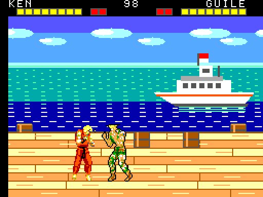
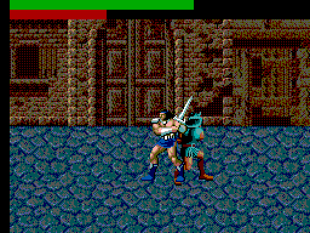
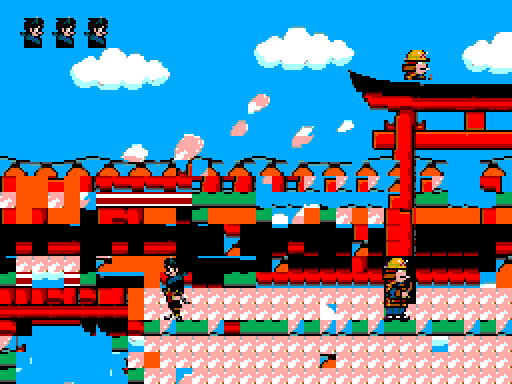
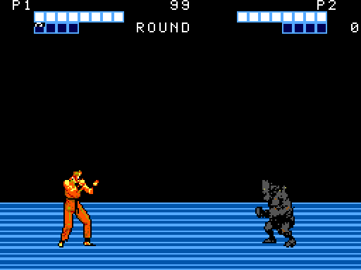
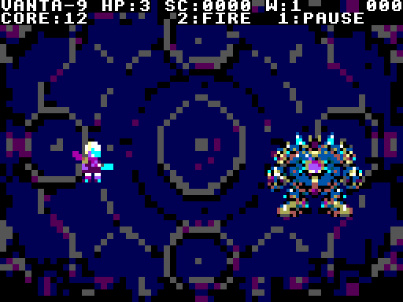
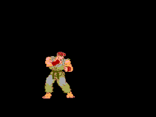
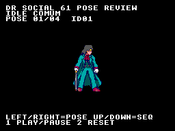

<div align="center">

# SMSForge

### Ideias, ferramentas e jogos reais para o Sega Master System

Um ambiente de produção com **SDCC + devkitSMS**, motores reutilizáveis,
arte, áudio PSG e um framework de agentes que trabalha com evidências do emulador.


[Projetos](#projetos-em-progresso) · [Galeria](#rodando-no-emulador) · [Ferramentas](#da-ideia-à-rom) · [Começar](#comece-por-aqui) · [Documentação](#mapa-do-repositório)



**MSSF2T — protótipo de combate 1×1 em execução no Emulicious.**

</div>

> **Todos os projetos apresentados estão em progresso.** As imagens registram
> versões específicas dos protótipos. Os GIFs são trechos reais, sem áudio e
> com taxa reduzida para a página; não certificam FPS, ausência de flicker ou
> o estado do build atual. [Fontes, versões e limites das capturas](doc/media/readme/README.md).

## O que estamos construindo

O SMSForge reúne o ambiente de desenvolvimento e os projetos usados para
evoluí-lo: jogos de luta, ação, experiências musicais e laboratórios de hardware.
O objetivo é produzir jogos com **visual marcante, som bem trabalhado,
comandos responsivos e cadência consistente**, respeitando o console.

O alvo de produção é **60 FPS em NTSC e 50 FPS em PAL**. A aprovação depende
da medição de cada ROM e da cena completa: uma animação bonita ou um contador
do emulador, isoladamente, não fecha a qualidade do jogo.

> **“Se não foi visto rodando no emulador, não existe.”**
>
> É o compromisso do projeto com execução observável, evidência rastreável
> e uma distinção clara entre o que está planejado, implementado e validado.

## Projetos em progresso

| Projeto | Frente de trabalho | Estado e próximos passos |
|---|---|---|
| **MSSF2T** | Combate 1×1, HUD, cenário e áudio PSG | Protótipo executado no emulador. Continuidade do input, orçamento e acabamento seguem em evolução. |
| **OpenBOR SMS** | Conversão de módulos e motor de beat ’em up | M6 registrado com ataque, perseguição em profundidade, pulo, queda, dano e morte. Áudio e fechamento da entrega seguem pendentes. |
| **MUGEN → SMS · rev2** | Importação de Ken/Ryu e motor de luta | ROMs diagnósticas dos pares Ken/Ken, Ryu/Ryu e cruzados. Render simultâneo, cadência, comandos e fidelidade da conversão ainda em desenvolvimento. |
| **HAMOOPIG** | Luta com Ryo e Musgo | Seleção e ciclos de animação registrados no emulador. Mecânicas e validação integral continuam em progresso. |
| **Kage Matsuri** | Ação, movimento, combate e apresentação de cena | Protótipo executável com cenário e ciclos de ação capturados. Orçamento do ciclo completo e acabamento seguem em trabalho. |
| **Arena Nocturna** | Ação com projéteis, boss e efeitos de impacto | Coreografia de atração registrada. Controle humano e orçamento completo permanecem etapas próprias de validação. |
| **Master of Fighters** | Direção de arte autoral e conversão de personagens | Concepts, model sheets e estudos de sprites em revisão. Há ROM diagnóstica histórica de poses; ainda não é um jogo de luta completo. |
| **Pulso de Cristal** | Experiência musical dirigida no PSG | Composição, transições e arbitragem de canais em evolução; aprovação por escuta humana segue pendente. |
| **Laboratório 01 e probes** | Engines de base e experimentos de Z80/VDP | Estudos de scroll, sprites, memória, streaming e orçamento alimentam as ferramentas e os próximos jogos. |

O `luta_mugen` original permanece como histórico de experimentos e aprendizado;
a frente paralela de continuidade é `luta_mugem_rev2`. O estado operacional
de cada consumidor fica no seu `doc/10-memory-bank.md`.

## Rodando no emulador

### Ação, combate e animação

<table>
  <tr>
    <td width="50%" valign="top">
      <h4>OpenBOR SMS</h4>
      
      <p><strong>Beat ’em up · em progresso</strong><br>Pulo em uma ROM do piloto M6. Ataque, dano e perseguição também têm registros próprios.</p>
    </td>
    <td width="50%" valign="top">
      <h4>Kage Matsuri</h4>
      
      <p><strong>Ação · em progresso</strong><br>Cenário colorido, personagens e ciclos de combate em uma captura histórica do protótipo.</p>
    </td>
  </tr>
  <tr>
    <td width="50%" valign="top">
      <h4>HAMOOPIG</h4>
      
      <p><strong>Luta 1×1 · em progresso</strong><br>Estudo de personagens, animação e HUD com Ryo e Musgo.</p>
    </td>
    <td width="50%" valign="top">
      <h4>Arena Nocturna</h4>
      
      <p><strong>Ação com boss · em progresso</strong><br>Trecho da atração automática com projéteis e reação de impacto.</p>
    </td>
  </tr>
</table>

No OpenBOR M6, a medição de runtime registrou **59,48 / 59,66 / 59,78 FPS**
em três janelas. O worst-frame registrou **zero incrementos do contador de
overflow em 3.000 quadros**, no cenário medido. Esses resultados pertencem à
ROM `76cdbee3…`; o GIF acima foi produzido por stepping e não mede velocidade.
[Runtime](doc/media/readme/records/openbor-runtime.json) ·
[Worst-frame](doc/media/readme/records/openbor-worst-frame.json).

<details>
<summary><strong>Pesquisa em andamento: MUGEN rev2 e Master of Fighters</strong></summary>

### MUGEN → Master System · rev2



Captura nativa da ROM v025, do par Ryu/Ken. **Somente um ator está visível
neste quadro.** Ela documenta render diagnóstico; a apresentação simultânea
dos lutadores permanece em desenvolvimento. O objetivo é converter dados de
personagem, animações, colisões e comandos por perfis de compatibilidade,
com as adaptações do Master System declaradas.

[Parecer e plano de continuidade](SMS_projects/luta_mugem_rev2/doc/24-parecer-continuidade-20261018.md).

### Master of Fighters



Prova histórica de conversão de uma pose de Dr. Social para o framebuffer
do console. **A fonte artística dessa prova foi posteriormente substituída**;
a imagem não representa a direção visual final aprovada nem gameplay completo.
A frente atual trabalha identidade do elenco, model sheets, sprites,
continuidade de animação e orçamento de conversão.

[Registro das duas capturas e seus limites](doc/media/readme/README.md#capturas-diagnósticas).

</details>

## Da ideia à ROM

### Um fluxo de produção compartilhado

```text
Design e storyboard → coreografia → medição e orçamento
→ contrato de asset → arte e áudio → runtime → evidência no emulador
```

O wrapper central concentra build, conversão de recursos e auditorias.
Os projetos mantêm seus dados, código e documentos de autoridade. As lições
reutilizáveis voltam ao framework canônico para orientar o próximo trabalho.

| Área | O que o ambiente oferece |
|---|---|
| **Build** | SDCC, SMSlib/PSGlib, empacotamento de ROM e bancos de dados. |
| **Gráficos** | Contratos de paleta e tiles, simulador de sprites por scanline, orçamento de VRAM e comparação entre arte e captura. |
| **Animação e importação** | Conversores MUGEN/OpenBOR em evolução, pivôs, sequências, colisões e compatibilidade explícita por perfil. |
| **Áudio** | Streams PSG, composição, SFX, arbitragem de canais, proveniência e captura isolada. |
| **Diagnóstico** | Probes de RAM, contadores da ROM, worst-frame, dumps de CPU/VDP/mapper e análise de estados. |
| **Agentes** | Skills por domínio, workflows, Harness e revisão por subagentes nativos em sessões próprias de QA. |
| **Rastreabilidade** | Hashes de ROM e assets, evidência por sessão, memória de projeto, registros de arte e conciliação de declarações. |

### Dois emuladores, papéis definidos

| Rota | Quando usar |
|---|---|
| **Emulicious** | Execução principal, input automatizado, framebuffer, áudio isolado e medição de runtime em sessões privadas. |
| **BlastEm** | Diagnóstico complementar de Z80, VDP e mapper, snapshots e investigação de escritas/estados, dentro do suporte comprovado do backend SMS. |

As sessões privadas separam display, configuração e controles do teste do
teclado e das janelas do usuário. Uma captura sempre deve apontar para a
ROM e a sessão certas. Capacidades de outro console ou do debugger nativo
não são transferidas automaticamente ao protocolo GDB ou ao backend SMS.

[Sessões isoladas](tools/sms_wrapper/.agent/workflows/emulator-isolated-session.md) ·
[Diagnóstico BlastEm](tools/sms_wrapper/.agent/workflows/blastem-sms-diagnostics.md).

### Qualidade com contexto

A última rodada de curadoria registrada em **18/10/2026** inclui **120/120
verificações do selftest**, **70 ferramentas de medição com self-check
aprovado** e **25/25 vetores de reteste independente** do novo auditor de
casos observados. São resultados da infraestrutura, não uma aprovação de
todos os jogos.

O fechamento global de documentação ainda registra dez problemas do legado
`luta_mugen` associados a erro de I/O. A entrega de cada jogo continua exigindo
build, validação, boot, gameplay, FPS, áudio e memória atualizada, além dos
critérios visuais e do vínculo entre asset e ROM.

[Resultado e limitações da curadoria](doc/curation/evidence/2026-10-18_observed_cases/summary.md).

## Desenvolver para o Master System

| Recurso | Referência de trabalho |
|---|---|
| **CPU e RAM** | Z80; 8 KB de RAM. Buffers estáticos e aritmética inteira no caminho quente. |
| **VDP e VRAM** | 16 KB de VRAM, sem DMA. Mapa de memória e janela de transferência fazem parte do orçamento da cena. |
| **Sprites** | Até 64 entradas na SAT e oito sprites por scanline. Tamanho dos personagens, efeitos e HUD precisam caber juntos. |
| **Cor** | Paleta mestra de 64 códigos; duas paletas de 16 entradas. O índice zero de sprite é transparente; o de BG é visível. |
| **Áudio** | PSG com três canais de tom e um de ruído; música e efeitos compartilham recursos. |
| **Cadência** | Alvos de 60/50 FPS conforme a região. Ritmo da emulação, avanço da lógica e apresentação da animação são medidos separadamente. |

A ambição visual é explorar bem esses recursos e preservar a leitura da
ação. Mais pixels e mais poses só agregam ao jogo quando conseguem aparecer
com o timing e a resposta esperados.

## Comece por aqui

### 1. Prepare o ambiente

O procedimento assistido é voltado a Linux. Instalação manual, headers e
procedimentos de toolchain estão em [sdk/README.md](sdk/README.md).

```sh
git clone https://github.com/Misael-art/sms-forge.git
cd sms-forge
bash tools/sms_wrapper/ensure_toolchain.sh
```

Emuladores e dependências locais não são distribuídos junto do código.
Configure a rota de [sessão privada](tools/sms_wrapper/.agent/workflows/emulator-isolated-session.md)
antes de automatizar execução ou captura.

### 2. Crie e compile um projeto

```sh
bash tools/sms_wrapper/new_project.sh meu_jogo
cd SMS_projects/meu_jogo
./build.sh
```

O bootstrap cria os documentos e delega a compilação ao wrapper central.
Uma ROM de esqueleto comprova o início do projeto; gameplay, arte e áudio
evoluem em etapas próprias.

### 3. Abra uma sessão de emulador

Depois de preparar as dependências da sessão, a partir da raiz do repositório:

```sh
python3 tools/sms_wrapper/emulator_session.py isolated start \
  SMS_projects/meu_jogo/out/rom/meu_jogo.sms
```

Guarde o ID retornado. A sessão nasce pausada; substitua `ID_DA_SESSAO` abaixo:

```sh
python3 tools/sms_wrapper/emulator_session.py isolated step ID_DA_SESSAO 120
python3 tools/sms_wrapper/emulator_session.py isolated capture ID_DA_SESSAO --name boot.png
python3 tools/sms_wrapper/emulator_session.py isolated close ID_DA_SESSAO
```

O stepping permite observar quadros; medir FPS exige execução contínua e o
probe apropriado. Para contribuir com agentes, leia primeiro o
[AGENTS.md](AGENTS.md) e a [arquitetura canônica](tools/sms_wrapper/.agent/ARCHITECTURE.md).

<details>
<summary><strong>Verificações da infraestrutura, quando necessárias</strong></summary>

```sh
python3 tools/sms_wrapper/selftest.py
python3 tools/sms_wrapper/validate_measurement_tools.py
```

Self-checks verificam o comportamento das ferramentas. A validação de um
jogo exige executar sua ROM, observar as consequências dos comandos e
reunir evidências da versão correspondente.

</details>

## Mapa do repositório

```text
SMSForge/
├── AGENTS.md                  Contrato de entrada dos agentes
├── tools/sms_wrapper/
│   ├── .agent/                Regras, skills, workflows e pipelines
│   ├── mugen2sms/             Conversão MUGEN → SMS
│   ├── openbor2sms/           Conversão OpenBOR → SMS
│   └── *.py                   Build, captura, medição e auditorias
├── SMS_projects/              Jogos, protótipos e seus documentos
│   └── _laboratorio/          Experimentos controlados de hardware
├── SMS_Engines/               Bases de runtime reutilizáveis
├── sdk/                       Procedimentos da toolchain
└── doc/
    ├── agent_learning/        Memória e rotas de aprendizado
    ├── curation/              Lições, aplicação e evidências
    ├── planejamento/          Planos e pareceres de continuidade
    └── media/readme/          Galeria pública, fontes e hashes
```

**Leituras úteis:** [Framework](tools/sms_wrapper/.agent/ARCHITECTURE.md) ·
[Regras técnicas](tools/sms_wrapper/.agent/rules/SMS_GLOBAL.md) ·
[Motor OpenBOR](tools/sms_wrapper/openbor2sms/README.md) ·
[Planos OpenBOR](doc/planejamento/openbor_sms/01-plano-openbor-sms.md) ·
[Curadoria](doc/curation/) · [Galeria rastreável](doc/media/readme/manifest.json).

## Créditos e licença

Construído com SDCC, devkitSMS/SMSlib/PSGlib, Emulicious, BlastEm e o
aprendizado compartilhado com o SGDK Forge. Os conversores estudam os
formatos e as mecânicas de MUGEN e OpenBOR.

O código original do projeto segue a licença MIT. Ferramentas de terceiros,
personagens, marcas, músicas e assets de referência mantêm suas respectivas
licenças e autorias; a licença do repositório não transfere esses direitos.

---

<div align="center">

**Em desenvolvimento. Cada protótipo melhora o ambiente; cada evidência orienta o próximo jogo.**

</div>
