# Fluxo de criação e curadoria de arte autoral

**Projeto:** Master of Fighters
**Estado registrado:** 2026-10-10
**Escopo:** do pedido inicial à aprovação de arte, conversão SMS, ROM diagnóstica e promoção futura para produção.

Este mapa distingue decisões de design, aprovação visual, prova técnica e integração. Uma etapa não herda a aprovação da etapa anterior: concept aprovado não significa sprite aprovado; sprite convertido não significa animação validada; ROM diagnóstica não significa ROM de produção.

## Estado em uma leitura

- **Aprovado:** formulário do concept model sheet; fonte do Dr. Social com 61 poses para conversão; conversão pixel a pixel e exibição dos 61 quadros na ROM diagnóstica v5.
- **Estamos aqui:** revisão visual do Dr. Social convertido na ROM. O teste 61/61 confirma fidelidade dos pixels renderizados, não a aprovação artística do resultado.
- **Pendente:** harmonia final do elenco, aceite visual/runtime da prova técnica de duas poses, reprodução contínua das sequências, paleta P1 integrada, budgets de cena e produção/gameplay.

## Fluxograma

```mermaid
flowchart TD
    A["1 · Pedido de arte autoral ou modificação do jogo"] --> B["2 · Intake: jogo, personagem, objetivo, plataforma e mudanças permitidas"]
    B --> C["3 · Referências e identidade: papéis, proveniência, invariantes e hash"]
    C --> D["4 · Definir estilo: catálogo indexado, obra/era e artista ou estúdio"]
    D --> E["5 · Concept model sheet padrão: frente, perfil, costas, rosto, pose-assinatura, escala e ficha"]
    E --> F{"6 · Revisão independente e double-check passam?"}
    F -->|Não| E
    F -->|Sim| G{"7 · Aprovação explícita do dono para este arquivo/hash?"}
    G -->|Não| E
    G -->|Sim| H["8 · Para elenco: prancha de harmonia, até 5 por folha, escala e acabamento comuns"]
    H --> I{"A harmonia do elenco foi aprovada?"}
    I -->|Não| H
    I -->|Sim| J["9 · Contrato de animação por ação: estados, poses, objetos, timing e 12 princípios"]
    G -. "personagem isolado / estudo técnico" .-> J
    J --> K["10 · Prova técnica de conversão: duas poses, paleta, tiles, escala, terminais e orçamento"]
    K --> L{"Revisão visual e gates técnicos da prova passaram?"}
    L -->|Não| K
    L -->|Sim| M["11 · Folha-fonte de animação aprovada, ligada por papel e SHA ao contrato"]
    M --> N["12 · Conversão indexada da folha aprovada; a prova de duas poses nunca a substitui"]
    N --> O["13 · Gates de pixels e hardware: paleta, recorte, geometria, tiles, SAT e scanline"]
    O -->|Falha: corrigir fonte/conversão e repetir| N
    O --> P["14 · ROM diagnóstica, vínculo asset→ROM e inspeção em sessão isolada do emulador"]
    P --> Q{"Pixels e animação foram revisados no ROM e aprovados pelo dono?"}
    Q -->|Não| N
    Q -->|Sim| R["15 · Integração de produção: elenco, P1 compartilhada, cenário/HUD, residência e VBlank"]
    R --> S["16 · Gameplay e budgets medidos: ROM/RAM, VRAM, timing, 50/60 fps, áudio e interação"]
    S --> T{"Todos os gates de produção e evidências atuais passaram?"}
    T -->|Não| R
    T -->|Sim| U["17 · Asset promovido e ROM de produção submetida à validação final"]
    F -. "falha ou aprendizado reutilizável" .-> V["Curadoria: registrar caso, regra, ferramenta e evidência; atualizar o fluxo"]
    O -. "falha ou aprendizado reutilizável" .-> V
    P -. "falha ou aprendizado reutilizável" .-> V
    V -. "alimenta próximos ciclos" .-> B

    W["Exercício atual: fonte Dr. Social de 61 poses aprovada pelo dono para conversão"] -. "ramo diagnóstico autorizado; não promove para produção" .-> N
    P -. "estado atual: ROM v5" .-> X["61/61 quadros comparados pixel a pixel; revisão artística final e runtime contínuo ainda pendentes"]

    classDef approved fill:#dff3e5,stroke:#32734b,color:#173321;
    classDef current fill:#fff1c9,stroke:#9b7100,color:#3e2e00;
    classDef pending fill:#f9e0e0,stroke:#a84343,color:#451616;
    classDef process fill:#e7edf7,stroke:#526d98,color:#1d2c43;
    class A,B,C,D,E,F,G,J,K,L,M,N,O,P,Q,R,S,T,U,V process;
    class W approved;
    class X current;
    class H,I pending;
```

**Legenda:** verde = fonte/decisão já aprovada em seu escopo; amarelo = ponto atual de validação; vermelho = gate pendente; azul = etapa do método que continua exigindo decisão/evidência própria. A cor do nó não declara que todas as execuções daquele passo já foram aprovadas.

## Estado de cada etapa

| Etapa | Estado atual | O que está aprovado ou falta |
|---|---|---|
| Entrada, referência e escolha de estilo | **Método estabelecido** | O fluxo exige objetivo, plataforma, identidade, papel de cada referência e direção artística explícita. Há 49 estilos indexados como catálogo inicial expansível; catálogo não significa que todos os estilos ou folhas estejam validados. A referência artística deve nomear artista/estúdio e obra quando confirmados, separar atribuição de inferência e descrever traços visuais observáveis. |
| Concept model sheet | **Padrão aprovado** | Formato: frente, perfil, costas, detalhe do rosto, pose de assinatura, escala relativa/baseline e ficha com estilo, lineart, morfologia, sombreamento, biotipo, paleta e detalhes invariáveis. Aprovação do formulário não aprova automaticamente cada arte ou variação. A base visual de Dr. Social foi provisoriamente aprovada, com possibilidade de revisão futura. |
| Revisão artística | **Gate estabelecido; precisa ser concluído por asset** | Revisão independente, dupla passagem de anatomia e estilo, hash-bound, depois decisão do dono. Confere rosto, mãos, continuidade do ombro ao punho, pega/arma, encaixes, proporção, contorno, paleta, recorte, assinatura do estilo e composição da folha. `fail`, `pending` ou falta de aprovação impedem promoção. |
| Harmonia do elenco | **Pendente; não promovida** | As pranchas comparativas encontraram diferenças de escala, morfologia, densidade de pixels e acabamento. A revisão existente registra falhas e pendências por personagem. Permanecem como alvos de revisão Landau ≈ Dr. Social/Shinobi, J.J. ≈ Hayato, J.J. com arma fiel à referência Zillion e todos sem leitura chibi, ruído ou contorno sujo. A prancha só fecha com comparação visual conjunta e aceite do dono. |
| Contrato de animação | **Estrutura documentada; conteúdo ainda parcial** | Há contrato do Dr. Social para 24 ações propostas. A folha atualmente exercitada cobre nove sequências básicas e 61 poses. O contrato obriga estados inicial/final, trilhas separadas para personagem e objetos, duração/IDs, física aplicável e revisão dos 12 princípios, com ao menos sete efeitos planejados por animação. Planejamento dos princípios não prova que o movimento final os realiza. Golpes e frame-data continuam propostas até pesquisa, balanceamento e validação. |
| Prova técnica de conversão | **Candidata; aprovação visual/runtime pendente** | A ficha de duas poses v4 existe e mede a conversão, mas seu registro mantém revisão visual e runtime pendentes — inclusive confirmação do terminal da bengala, anatomia, altura corporal sem equipamento e orçamento da cena. Ela prova o método; não é a fonte da animação de 61 poses. |
| Fonte aprovada para conversão | **Aprovada pelo dono no escopo declarado** | PNG `dr_social_basic_sequences_61f_owner_source_v1.png`, SHA-256 `a95fc144f6d2574a9dfb43028b7b1d1fc91108b442f03fcfebac2df3f6d56057`: idle 4, avanço 8, recuo 8, pulo 8, abaixar 5, dash 8, queda 8, rolagem/levantada 8, defesa 4. Aprovação da fonte autoriza convertê-la; não aprova a imagem indexada, timing, arte no ROM ou integração. |
| Conversão e ROM diagnóstica v5 | **Conversão pixel a pixel passou; arte final ainda aguarda revisão** | Foram convertidas 61 imagens indexadas 80×80. Gates registrados de recursos, procedência, geometria, SAT/scanline e vínculo asset→ROM passaram. No Emulicious, os 61 IDs foram navegados e comparados ao framebuffer: 61/61 correspondências exatas. É uma ROM diagnóstica fora de `res/`, não ROM de gameplay. A validação de pixel exato não substitui revisão artística humana. |
| Limite de padrões e animação contínua | **Limite medido; solução de produção pendente** | No layout de diagnóstico, há 191 patterns residentes antes da name table. Idle (169) e defesa (182) podem compartilhar pool; as outras sete sequências são inspecionadas pose a pose. O viewer não prova timing contínuo, upload dentro do VBlank ou integração com cenário/HUD. A solução precisa respeitar residência, RAM/ROM, SAT, scanline e orçamento por cena medido. |
| Paleta e integração no jogo | **Pendente** | A regra é compartilhar P1 entre sprites simultâneos; P0 atende cenário/HUD conforme o contrato do projeto. A alocação P1 final do elenco e a convivência com cenário/HUD ainda não foram aprovadas/medidas. Nada desta ROM diagnóstica foi promovido a `res/`. |
| ROM de produção | **Ainda não iniciada como entrega final** | Faltam harmonia final do elenco, revisão de arte convertida, ciclos reais de animação, gameplay e balanceamento, budgets de cena, paleta integrada, build de produção, evidências atuais de boot/gameplay/FPS/áudio e validação final no emulador. |
| Curadoria | **Regra já alimentada por casos concretos** | L121 registra a fronteira entre fonte de prova e fonte de animação; L122 registra a fonte aprovada de 61 poses e o limite físico de patterns, ligados a ferramentas e evidências. Novas falhas devem atualizar registro, regra e medição, não ficar apenas como nota narrativa. |

## Próximos gates, na ordem de promoção

1. Revisar visualmente a conversão v5 no ROM e aprovar/reprovar o resultado do Dr. Social. Em caso de falha, corrigir a fonte ou a conversão e gerar nova evidência vinculada ao novo SHA.
2. Fechar a revisão da prova técnica v4 separadamente, incluindo a ponta da bengala e a altura anatômica sem equipamento; não usá-la como folha de animação.
3. Corrigir e aprovar a prancha de harmonia do elenco, com as relações de escala e fidelidade da arma de J.J. explicitadas acima.
4. Escolher e medir uma estratégia de residência/streaming para as sete sequências que não cabem no pool de 191 patterns; demonstrar animação contínua e custo de VBlank em ROM.
5. Fechar paleta P1 compartilhada, cenário/HUD, residência conjunta, RAM/ROM, SAT/scanline e budgets de pior quadro por cena.
6. Integrar os assets aprovados em `res/`, ligar hashes e símbolos à ROM de produção, implementar gameplay e revisar timing, física e balanceamento no emulador.
7. Capturar a evidência final contra o binário atual. Só então promover o asset e classificar a ROM conforme os eixos realmente medidos.

## Registros de referência

- Fonte e escopo das 61 poses: `data/source_art/sprite_studies/dr_social/dr_social_basic_sequences_61f_owner_source_v1.json`.
- Linhagem da conversão: `doc/dr_social_61_pose_source_lineage_v1.json`.
- Estado operacional e hashes do viewer: `doc/10-memory-bank.md`.
- Contrato de animação: `doc/dr_social_animation_contract_v1.md` e `.json`.
- Contratos de escala e harmonia: `doc/roster_harmony_contract_v1.json` e revisões associadas.
- Contrato técnico e limites de runtime: `doc/15-tdd.md`.
- Lições canônicas: `doc/curation/2026-10-10_l121_sms_asset_to_rom_conversion.json` e `doc/curation/2026-10-10_l122_aprovacao_fonte_61_poses_janela_patterns.json`.
- Regra transversal para o agente canônico: workspace `doc/curation/2026-10-10_l123_ciclo_arte_autoral_ate_rom.json` e `tools/sms_wrapper/.agent/workflows/artwork-to-rom-lifecycle.md`.
